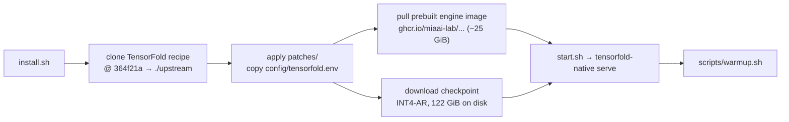
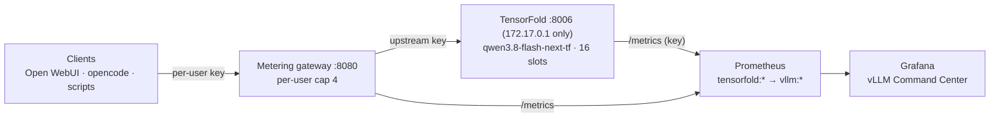

# Qwen3.8-Flash-Next (INT4-AutoRound, TensorFold) on NVIDIA DGX Spark (GB10)

## Overview

Serving recipe for **Qwen3.8-Flash-Next** on a single NVIDIA DGX Spark using
**TensorFold's Zig engine** and the community **INT4-AutoRound, top-5-expert**
checkpoint: 16 concurrent users, **400 tok/s peak output**, 262,144-token
context, vision, MTP speculative decoding, behind a per-user metering gateway
with Grafana monitoring.

| | |
|---|---|
| Model | `Qwen/Qwen3.8-Flash-Next` (arch `qwen4_exp`: QSA sparse attention + Gated DeltaNet, 512 routed experts, MTP head, vision tower) |
| Checkpoint | [`azampatti/Qwen3.8-Flash-Next-125B-A5B-INT4-AutoRound`](https://huggingface.co/azampatti/Qwen3.8-Flash-Next-125B-A5B-INT4-AutoRound) @ `1464274` |
| Engine | [TensorFold](https://github.com/ashhart/TensorFold) `tensorfold-native` via [MiaAI-Lab's recipe](https://github.com/MiaAI-Lab/Qwen3.8-Flash-Next-Single-DGX-Spark-TensorFold) @ `364f21a` |
| Served as | `qwen3.8-flash-next-tf` on `172.17.0.1:8006` (gateway `:8080`) |
| Concurrency | `PARALLEL=16` |
| Peak output | **400.4 tok/s** aggregate at 16 users; **53.1 tok/s** single user |
| Prefill | ~2,200–2,400 tok/s cold; **0.08–0.20 s** on a prefix-cache hit |
| Memory | 65.7 GiB weights + 27.5 GiB sequence pool (≈6 full 262K windows) |
| Cold start | ~2 min |

**Trade-offs, measured below:** this checkpoint runs **5 of 512 experts per
token instead of 10**, which the checkpoint authors report as ~10% lower
general capability than the full model; while one request prefills a new
long prompt, **every other stream pauses** (32K prompt: ~13 s); structured
outputs (`response_format`) are not supported.

## Table of Contents

- [Architecture](#architecture)
- [Hardware & Software Requirements](#hardware--software-requirements)
- [Quick Start](#quick-start)
- [Quantization](#quantization)
- [Configuration Reference](#configuration-reference)
- [Hosting on This System](#hosting-on-this-system)
- [Metering Gateway & Tailscale](#metering-gateway--tailscale)
- [Benchmarks](#benchmarks)
- [Live Monitoring](#live-monitoring)
- [Client Usage](#client-usage)
- [Repository Layout](#repository-layout)
- [Troubleshooting](#troubleshooting)
- [Credits & License](#credits--license)

## Architecture

### Build pipeline



### Request flow



## Hardware & Software Requirements

- DGX Spark / GB10, 121 GiB unified memory, **nothing else large on the GPU**
  (the engine needs ~92 GiB `MemAvailable` at start)
- ~160 GB free disk: 122 GiB checkpoint + 25 GiB image
- Docker with the NVIDIA Container Toolkit

## Quick Start

```bash
git clone https://github.com/Hitheshkaranth/Qwen-3_8_Flash_Next_TensorFold_Model_DGX_Spark_Setup.git
cd Qwen-3_8_Flash_Next_TensorFold_Model_DGX_Spark_Setup
./gateway/setup.sh     # optional, recommended: upstream key + :8080 metering gateway
./install.sh           # recipe, patch, image, 122 GiB checkpoint, start, warm up
```

Every step skips work already done, so it is safe to re-run. `SKIP_START=1
./install.sh` downloads only.

> [!WARNING]
> Stop any other large model first (for example `docker stop vllm-ornith-a3b`).
> `scripts/switch-model.sh tensorfold|other` does the swap in both directions.

> [!NOTE]
> `start.sh`'s built-in smoke test does not send the API key, so with a key set it
> prints `ERROR: the smoke test request failed; the server is still running`.
> The server is fine; `scripts/warmup.sh` is the real check.

## Quantization

The checkpoint stacks two reductions on the full model:

| Part | Precision |
|---|---|
| Routed experts (the bulk of the weights) | **INT4**, GPTQ format, group size 128, symmetric; Intel AutoRound calibration (`Intel/Qwen3.8-Flash-Next-W4A16-AutoRound`) |
| `lm_head` | INT4 |
| Linear + self attention, shared experts, router gates, embeddings, vision tower | BF16 (not quantized) |
| N-gram (PLE) table | FP8, 49 GiB on disk, loaded with the weights (no SSD reader) |
| KV cache | FP8 by default (~98.8% top-1 agreement with BF16); `KV_DTYPE=bf16` is exact |
| **Experts per token** | **5 of 512** (the full model uses 10): azampatti's top-5 cut with shared-expert healing, ~4.8B active parameters |

W4A16 means 4-bit weights with 16-bit activations. AutoRound tunes each
weight's rounding against calibration data rather than rounding to nearest.

Compared with the [vLLM NVFP4 build](https://github.com/Hitheshkaranth/Qwen3.8-Flash-Next_Model_DGX_Spark_Setup)
of the same model: both quantize the routed experts to 4 bits (NVFP4 there:
FP8 scale per 16 values, native FP4 math on Blackwell), that build keeps all
10 experts and quantizes attention and shared experts to MXFP8, while this one
keeps them BF16 but halves the experts. The expert cut, not INT4 vs NVFP4, is
where most of the speed and most of the reported capability loss come from.

## Configuration Reference

`config/tensorfold.env` becomes `upstream/.env` (read by the recipe's
`scripts/config.sh`):

| Variable | Value | Why |
|---|---|---|
| `PORT` / `HOST` | `8006` / `172.17.0.1` | reachable from the host and Docker (Prometheus), not the LAN |
| `SERVED_NAME` | `qwen3.8-flash-next-tf` | distinct from the vLLM build's `qwen3.8-flash-next` |
| `PARALLEL` | `16` | the recipe's maximum (default 8); 16 is the measured peak, 20 queues |
| `VISION` | `1` | image and video input; keeps 2 GiB for the vision helper |
| context / KV | 262,144 / fp8 | recipe defaults |
| `TENSORFOLD_API_KEY` | **environment only**, from `gateway/upstream.key` | never written to `.env` |

Sampling defaults come from the checkpoint (temperature 1.0, top_k 20, top_p
0.95, thinking on). MTP drafts are on.

`patches/0001-prepare-pass-HF_HUB_DISABLE_XET.patch` passes
`HF_HUB_DISABLE_XET` into the download container; Xet transfers stalled on
this network and `install.sh` sets it to 1.

## Hosting on This System

### Memory budget (121 GiB unified)

| Item | Size |
|---|---:|
| Weights incl. FP8 n-gram table | 65.7 GiB |
| Sequence pool at `PARALLEL=16`, vision on | 27.49 GiB (≈6 full 262K fp8 windows; shorter requests share it) |
| Kept free by the engine | 10 GiB + 2 GiB vision workspace |
| Left for OS, monitoring, gateway, Open WebUI | the rest (~15 GiB) |

Only one large model fits: TensorFold and the box's vLLM models take turns.

### Switching models

```bash
# Ornith (or any vLLM container) -> TensorFold Flash-Next
./scripts/switch-model.sh tensorfold

# TensorFold -> Ornith
./scripts/switch-model.sh other
OTHER=vllm-qwen38-a3b ./scripts/switch-model.sh other    # a different container
```

The TensorFold container has **no restart policy**; after a reboot the other
model (which keeps `--restart unless-stopped` while live) comes back, or run
`./scripts/switch-model.sh tensorfold`.

Open WebUI stores its default model in its sqlite `config` table (overrides the
`DEFAULT_MODELS` env var): change it in Admin → Settings → Models after a swap.

## Metering Gateway & Tailscale

`gateway/` is the same per-user / per-device metering proxy as the other repos
([`docs/GATEWAY.md`](docs/GATEWAY.md)): clients get their own keys on `:8080`,
only the gateway holds the upstream key, usage lands in sqlite and Prometheus.
`GATEWAY_MAX_PER_USER` (default 4) keeps one client from taking every slot.
The gateway polls each backend's `/v1/models` every 10 s and routes by model
name, so after a swap the new name appears within 10 s.

## Benchmarks

All on the reference box, 2026-10-09/10, same scripts as the Ornith and vLLM
Flash-Next repos. Raw output in `benchmarks/*.log`, `*.json`, `*.jsonl`;
charts regenerate with `python3 benchmarks/make_charts.py`.

### Raw Token Rate


`benchmarks/throughput_bench.py`: 512 forced output tokens per request,
temperature 0.6, one warm-up; sent directly to `:8006`.

| Users | TensorFold aggregate | per user | vLLM Flash-Next | Ornith |
|---|---|---|---|---|
| 1 | **53.1** | 53.1 | 34.7 | 79.0 |
| 4 | 160.4 | 40.2 | – | – |
| 8 | 272.4 | 34.1 | 115.1 | – |
| 16 | **400.4** | 25.0 | 166.8 | 438.8 |
| 20 | 321.6 | 23.2 | 124.2 | **490.3** |

- Peak at `PARALLEL=16`; at 20 the extra 4 queue and aggregate falls.
- 2.4x the vLLM NVFP4 build at 16 users, ~91% of Ornith (a 3B-active model) at
  the same width.
- MTP draft acceptance 73.5%.
- With the recipe's default `PARALLEL=8`: 220.0 tok/s at 8 users.

### Reasoning & Problem Solving


`benchmarks/reasoning_bench.py`: thinking on, temperature 0.6 / top_p 0.95 /
top_k 20, 16 in flight, max_tokens 16,384 for math and 32,768 for long-form;
identical prompts and limits across all three.

| | TensorFold Flash-Next | vLLM Flash-Next | Ornith |
|---|---|---|---|
| GSM8K (100) | **99%** · 577 tok · 497 s | 99% · 469 tok · 354 s | 98% · 384 tok · 122 s |
| MATH-500 (100 integer answers) | **99%** · 1,500 tok · 1 truncated · 812 s | 100% · 1,342 tok · 0 truncated · 905 s | 97% · 1,937 tok · 3 truncated · 626 s |
| Long-form, 4 prompts | 28,592 tok avg, 3 at the 32K cap | 29,510 tok avg, 3 at cap | 17,804 tok avg, 1 at cap |

- Halving the active experts cost **nothing measurable on math**: one MATH-500
  problem ran out of tokens; everything else matches the full model.
- It thinks ~12% longer per MATH-500 answer than the vLLM build but finishes
  the set ~10% sooner thanks to the faster decode.
- Both math sets are near the ceiling for all three models; they confirm sound
  reasoning more than they separate the models. MMLU-Pro below is the harder
  test.
- Outputs were identical to the token across two runs at `PARALLEL` 8 and 16:
  this engine's sampling is deterministic per request.

### Knowledge: MMLU-Pro

Running: same 700-question stratified sample (50 per subject x 14, seed 0) as
the Ornith repo, zero-shot, thinking on, 8 in flight. Partial result on the
193 questions answered so far, against Ornith on the same questions:

| Same 193 questions | Ornith | TensorFold |
|---|---|---|
| Overall | 89.1% | **90.2%** |
| Biology / Business | 92% / 84% | 96% / 90% |
| Chemistry / Computer science | 90% / 91% | 88% / 86% |

`benchmarks/knowledge_compare.py a.jsonl b.jsonl` compares any two runs on
their common questions while a run is in progress. Ornith's full score is
81.1%.

### Prefill & Streaming Under Load

`benchmarks/prefill_bench.py` (measured at `PARALLEL=8`; prefill does not
depend on the slot count). Cold prompts start with a unique nonce; warm
resends the same prompt; TTFT with `max_tokens=1`.

| | 8K | 32K | 64K |
|---|---|---|---|
| Cold TTFT | 3.75 s | 14.48 s | 26.46 s |
| Cold prefill rate | 2,161 tok/s | 2,217 tok/s | 2,422 tok/s |
| Warm TTFT (cache hit) | **0.08 s** | **0.14 s** | **0.20 s** |
| vLLM Flash-Next warm TTFT | 0.79 s | 0.55 s | 1.72 s |

**Streaming under load:** with 7 streams decoding (quiet gap ~48 ms between
chunks), one cold 32K prompt took 12.9 s to its first token and **every
running stream paused for the whole 12.8 s**. vLLM's chunked prefill instead
keeps other streams moving in ~1 s steps. For agent traffic with fresh 30–60K
prompts, expect 15–30 s pauses for everyone else.

## Live Monitoring

- `monitoring/prometheus-scrape.yml`: the `tensorfold` job. `/metrics` needs
  the API key, read from a mounted file (`credentials_file`) so it never sits
  in the config; names are rewritten `tensorfold:*` → `vllm:*` and
  `model_name` is attached, so the vLLM dashboards work unchanged.
- `monitoring/grafana-dashboard.json`: the **vLLM Command Center** with the
  prefill / TTFT / queue latency row and per-user panels. Its output-rate line
  adds `generation_tokens_running`, because TensorFold only adds a request's
  tokens to `generation_tokens_total` when it finishes.
- `monitoring/gateway-bypass-alert.yml`: requests reaching the engine without
  the gateway.

## Client Usage

```python
from openai import OpenAI

client = OpenAI(api_key="<your gateway key>", base_url="http://<spark>:8080/v1")

resp = client.chat.completions.create(
    model="qwen3.8-flash-next-tf",
    messages=[{"role": "user", "content": "A snail climbs 3 m a day and slips 2 m a night in a 10 m well. How many days?"}],
    max_tokens=16384,
)
print(resp.choices[0].message.reasoning_content)   # the thinking trace
print(resp.choices[0].message.content)             # the answer: 8
```

`max_tokens` counts thinking and answer together; a tight limit returns an
empty `content`. For fast direct answers:

```python
client.chat.completions.create(
    model="qwen3.8-flash-next-tf",
    messages=[{"role": "user", "content": "Say OK."}],
    extra_body={"chat_template_kwargs": {"enable_thinking": False}},   # or {"reasoning_effort": "low"}
)
```

## Repository Layout

```
install.sh                     clone recipe @ pinned commit, patch, configure, pull, download, start, warm up
config/tensorfold.env          serving profile (no secrets)
patches/                       local fixes applied to the recipe
scripts/warmup.sh              wait for health, prefill one 8K prompt
scripts/switch-model.sh        swap with Ornith / another vLLM container
benchmarks/                    throughput, reasoning, knowledge (MMLU-Pro), prefill: scripts, results, charts
gateway/                       metering gateway (per-user keys, usage DB, per-user cap)
monitoring/                    Prometheus job (auth + relabel), Grafana dashboard, bypass alert
docs/GATEWAY.md                gateway guide
upstream/                      created by install.sh; not committed
```

## Troubleshooting

| Symptom | Fix |
|---|---|
| `start.sh` prints "smoke test request failed" | expected with an API key; check with `scripts/warmup.sh` |
| `start.sh` refuses: not enough memory | another model is resident; `scripts/switch-model.sh tensorfold` |
| Checkpoint download stalls | Xet: `HF_HUB_DISABLE_XET=1` (install.sh sets it); re-run, it resumes |
| `prepare.sh` dies on the memory preflight before downloading | `MEM_CHECK=0` (install.sh sets it): the floor is for serving, not downloading |
| Grafana shows the model down / `401` on `/metrics` | Prometheus needs the key file mounted (see `monitoring/prometheus-scrape.yml`) |
| Output-rate panel reads 0 during long requests | use the dashboard in this repo (adds in-flight tokens) |
| Everyone's stream pauses when one user sends a huge prompt | engine behavior during prefill; use the vLLM build for many-user long-prompt traffic |
| `response_format` returns HTTP 400 | not supported by this engine |
| `model ... is not being served` from the gateway | the gateway re-polls every 10 s after a swap; or the client uses the old model name |

## Credits & License

- Model: [Qwen3.8-Flash-Next](https://huggingface.co/Qwen/Qwen3.8-Flash-Next), Qwen team (Qwen Community License).
- Checkpoint: [azampatti](https://huggingface.co/azampatti) (top-5 cut, shared-expert healing), on
  [Intel's AutoRound INT4](https://huggingface.co/Intel/Qwen3.8-Flash-Next-W4A16-AutoRound) and
  [Saren-Arterius's](https://huggingface.co/Saren/Qwen3.8-Flash-Next-ple-table-fp8) hybrid checkpoint and FP8 n-gram table.
- Engine: [TensorFold](https://github.com/ashhart/TensorFold) (Apache-2.0 / MIT).
- Recipe: [MiaAI-Lab/Qwen3.8-Flash-Next-Single-DGX-Spark-TensorFold](https://github.com/MiaAI-Lab/Qwen3.8-Flash-Next-Single-DGX-Spark-TensorFold) (MIT).
- This repo: MIT (`LICENSE`).
