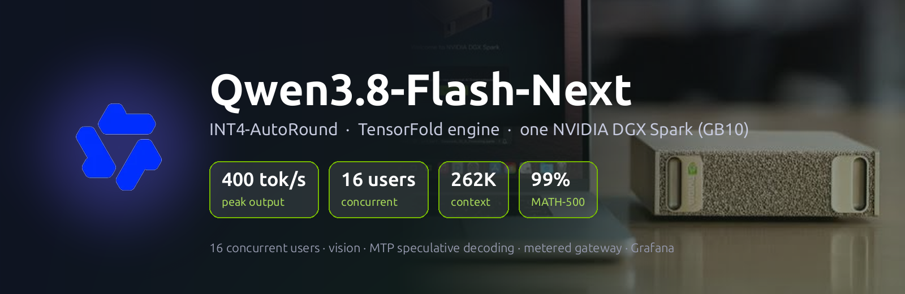
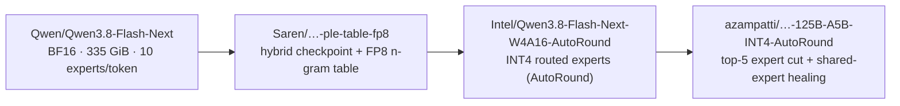
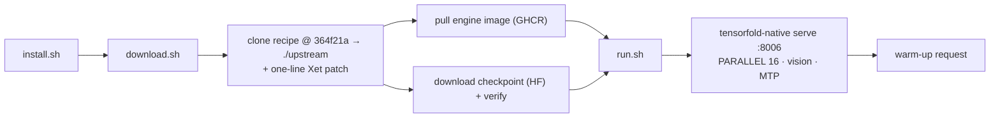
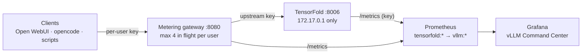
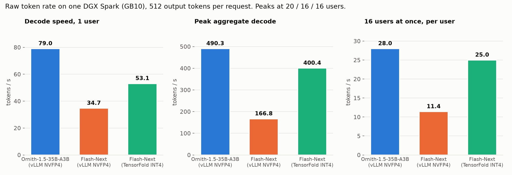
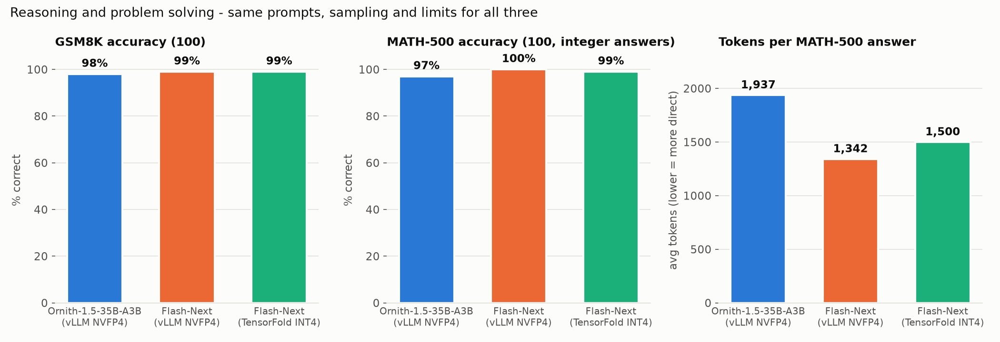

<div align="center">



# Qwen3.8-Flash-Next (INT4-AutoRound + TensorFold) on NVIDIA DGX Spark (GB10)

**Serve a 125B-parameter MoE with vision and multi-token prediction on one desktop box: 16 concurrent users, 262K context, 400 tok/s peak output**

[](https://huggingface.co/Qwen/Qwen3.8-Flash-Next)
[](https://huggingface.co/azampatti/Qwen3.8-Flash-Next-125B-A5B-INT4-AutoRound)
[-orange)](https://github.com/ashhart/TensorFold)
[-76B900)](https://www.nvidia.com/en-us/products/workstations/dgx-spark/)
[](#configuration-reference)
[](#throughput--mtp-speculative-decoding)
[](LICENSE)

[Quick Start](#quick-start) · [Model Source](#model-source) · [Benchmarks](#benchmarks) · [Hosting vs Ornith](#how-hosting-differs-from-ornith) · [Client Usage](#client-usage) · [Engineering Notes](docs/ENGINEERING.md)

</div>

---

## Overview

<div align="center">

</div>

This repository is the running configuration used to serve
[**`azampatti/Qwen3.8-Flash-Next-125B-A5B-INT4-AutoRound`**](https://huggingface.co/azampatti/Qwen3.8-Flash-Next-125B-A5B-INT4-AutoRound),
a 4-bit build of [Qwen/Qwen3.8-Flash-Next](https://huggingface.co/Qwen/Qwen3.8-Flash-Next), with
[TensorFold](https://github.com/ashhart/TensorFold)'s Zig inference engine on a single
**NVIDIA DGX Spark (GB10, Blackwell, 128 GB unified memory)**. It takes over from
[Ornith-1.5-35B-A3B](https://github.com/Hitheshkaranth/Ornith-1.5_A3B_Model_DGX_Spark_Setup) on the
same box, and replaces a first attempt at this model on
[vLLM with NVFP4](https://github.com/Hitheshkaranth/Qwen3.8-Flash-Next_Model_DGX_Spark_Setup)
that decoded 2.4x slower.

Unlike the box's earlier models, **this one doesn't run on vLLM**. The model's architecture
(QSA sparse attention + Gated DeltaNet, 512 experts, a per-layer n-gram table) needs its own
kernels, and TensorFold's engine is the fastest single-Spark option measured: it holds the whole
model, including the n-gram table, in memory and runs MTP speculative decoding with deep drafts.

### Highlights

| | |
|---|---|
| 🚀 **400.4 tok/s** peak aggregate output at 16 users | ⚡ **53.1 tok/s** for a single user |
| 🧠 **GSM8K 99% · MATH-500 99%** with thinking on | 🔁 **0.2 s** to first token on a repeated 64K prompt |
| 👁️ Image and video input | 📊 Per-user metering gateway + Grafana with peak-output panel |
| 💾 **~85 GiB** RAM in use under load (of 121 GiB) | ⏱️ **~2 min** cold start |

> [!IMPORTANT]
> The checkpoint runs **5 of 512 experts per token instead of the model's 10**. That's a big part
> of the speed, and its authors measure it at ~10% lower general capability than the full model.
> While one request reads a new long prompt, **every other stream pauses** (32K prompt: ~13 s).
> Both trade-offs are measured in [Benchmarks](#benchmarks).

> Every number in this README was measured on the deployment itself. See
> [`docs/ENGINEERING.md`](docs/ENGINEERING.md) for methodology and raw data in [`benchmarks/`](benchmarks/).

## Table of Contents

- [Model Source](#model-source)
- [Architecture](#architecture)
- [Hardware & Software Requirements](#hardware--software-requirements)
- [Quick Start](#quick-start)
- [Manual Setup — Step by Step](#manual-setup--step-by-step)
- [Checkpoint & Quantization](#checkpoint--quantization)
- [Configuration Reference](#configuration-reference)
- [Hosting on This System](#hosting-on-this-system)
  - [How hosting differs from Ornith](#how-hosting-differs-from-ornith)
  - [Memory: total RAM consumed](#memory-total-ram-consumed)
- [Metering Gateway & Tailscale](#metering-gateway--tailscale)
- [Benchmarks](#benchmarks)
  - [Throughput & MTP Speculative Decoding](#throughput--mtp-speculative-decoding)
  - [Reasoning & Problem Solving](#reasoning--problem-solving)
  - [Knowledge: MMLU-Pro](#knowledge-mmlu-pro)
  - [Prefill & Streaming Under Load](#prefill--streaming-under-load)
- [Live Monitoring](#live-monitoring)
- [Client Usage](#client-usage)
- [Repository Layout](#repository-layout)
- [Troubleshooting](#troubleshooting)
- [Credits & License](#credits--license)

## Model Source

Everything is downloaded by [`download.sh`](download.sh), pinned to exact revisions:

| What | Where it comes from | Pinned at | Size |
|---|---|---|---|
| **Weights** | 🤗 [`azampatti/Qwen3.8-Flash-Next-125B-A5B-INT4-AutoRound`](https://huggingface.co/azampatti/Qwen3.8-Flash-Next-125B-A5B-INT4-AutoRound) | `1464274120d36a4d8fcaa934552334a7d83ce0fd` | 122 GiB on disk (70 shards + 33 n-gram files) |
| **Engine image** | `ghcr.io/miaai-lab/qwen3.8-flash-next-single-dgx-spark-tensorfold` | `zig-db28187-4144696f21e3` | 24.6 GiB |
| **Engine source** | [`ashhart/TensorFold`](https://github.com/ashhart/TensorFold), branch `zig-flashnext` | `db281878` | (inside the image) |
| **Serving recipe** | [`MiaAI-Lab/Qwen3.8-Flash-Next-Single-DGX-Spark-TensorFold`](https://github.com/MiaAI-Lab/Qwen3.8-Flash-Next-Single-DGX-Spark-TensorFold) | `364f21a` | cloned to `./upstream` |

The weights land in the Hugging Face cache
(`~/.cache/huggingface/hub/models--azampatti--Qwen3.8-Flash-Next-125B-A5B-INT4-AutoRound/`), not in
`./models` as in the vLLM repos. How the checkpoint was built, step by step:



## Architecture

### Build pipeline



### Request flow



## Hardware & Software Requirements

| | Required |
|---|---|
| Hardware | NVIDIA DGX Spark / GB10 (121 GiB unified memory), **no other large model resident** |
| Free memory at start | ~92 GiB `MemAvailable` |
| Disk | ~160 GB free in `$HOME` (122 GiB checkpoint + 25 GiB image) |
| Software | Docker + NVIDIA Container Toolkit, git, curl, python3 |

## Quick Start

**One line**, on a DGX Spark with Docker and the NVIDIA Container Toolkit set up:

```bash
curl -fsSL https://raw.githubusercontent.com/Hitheshkaranth/Qwen-3_8_Flash_Next_TensorFold_Model_DGX_Spark_Setup/main/install.sh | bash
```

The script checks prerequisites, clones the repo, downloads the recipe, image and checkpoint, and
starts the server. Each step skips work that's already done, so it's safe to re-run.

Prefer to clone it yourself first? Same result:

```bash
git clone https://github.com/Hitheshkaranth/Qwen-3_8_Flash_Next_TensorFold_Model_DGX_Spark_Setup.git
cd Qwen-3_8_Flash_Next_TensorFold_Model_DGX_Spark_Setup
./download.sh && ./run.sh
```

> [!WARNING]
> On GB10 only **one** large model fits. If another is serving (for example Ornith on `:8004`),
> stop it first: `docker update --restart no vllm-ornith-a3b && docker stop vllm-ornith-a3b`.

## Manual Setup — Step by Step

<details>
<summary><b>1. Gateway first (recommended)</b></summary>

```bash
./gateway/setup.sh          # venv, upstream.key, admin key, systemd user service on :8080
```

`run.sh` reads the upstream key from `~/Documents/llm-gateway/upstream.key` or
`gateway/upstream.key`; with no key the engine is open on `172.17.0.1:8006`.
</details>

<details>
<summary><b>2. Download</b></summary>

```bash
./download.sh               # recipe @ 364f21a, engine image, 122 GiB checkpoint, verification
```

Ends with `Checkpoint OK: qwen4_exp, AutoRound int4 g128, 33 n-gram table files, 224454 tensors in 70 shards`.
</details>

<details>
<summary><b>3. Run</b></summary>

```bash
./run.sh                    # start + warm up   (./run.sh restart · ./run.sh stop)
```

The recipe's own smoke test sends no key, so with a key set you'll see
`ERROR: the smoke test request failed; the server is still running` followed by
`ready: qwen3.8-flash-next-tf on http://172.17.0.1:8006 (…-token warm-up in …s)`. The second line
is the real check.
</details>

<details>
<summary><b>4. Monitoring</b></summary>

Add `monitoring/prometheus-scrape.yml` to Prometheus (it needs the key file mounted, see the file
header) and import `monitoring/grafana-dashboard.json`.
</details>

## Checkpoint & Quantization

| Part | Precision |
|---|---|
| Routed experts (the bulk of the weights) | **INT4**, GPTQ format, group size 128, symmetric, Intel AutoRound calibration |
| `lm_head` | INT4 |
| Linear + self attention, shared experts, router gates, embeddings, vision tower | BF16 (not quantized) |
| N-gram (PLE) table | FP8, 49 GiB on disk, held in memory |
| KV cache | FP8 (~98.8% top-1 agreement with BF16); `KV_DTYPE=bf16` is exact |
| **Experts per token** | **5 of 512** (full model: 10), ~4.8B active parameters |

W4A16 means 4-bit weights with 16-bit activations; AutoRound tunes each weight's rounding against
calibration data instead of rounding to nearest. Compared with the vLLM NVFP4 build: both are 4-bit
routed experts (NVFP4 uses an FP8 scale per 16 values and native FP4 math), that build keeps all
10 experts and quantizes attention to MXFP8, while this one keeps attention in BF16 but halves the
experts. **The expert cut, not INT4 vs NVFP4, is where most of the speed and the reported quality
loss come from.**

## Configuration Reference

All settings live at the top of [`run.sh`](run.sh), which writes them to `upstream/.env` on every
start (environment variables override):

| Setting | Value | Why |
|---|---|---|
| `PORT` / `HOST` | `8006` / `172.17.0.1` | reachable by the gateway and Prometheus, not the LAN |
| `SERVED_NAME` | `qwen3.8-flash-next-tf` | distinct from the vLLM build's `qwen3.8-flash-next` |
| `PARALLEL` | `16` | recipe maximum (default 8); measured peak, 20 users queue |
| `VISION` | `1` | image + video input; reserves 2 GiB for the vision helper |
| Context / KV | 262,144 / fp8 | recipe defaults (1M with YaRN possible, not used) |
| `TENSORFOLD_API_KEY` | from `upstream.key`, **environment only** | protects `/v1/*` **and** `/metrics` |
| `RESTART` | `unless-stopped` | production model; `RESTART=no ./run.sh` for a test run |

Sampling defaults come from the checkpoint: temperature 1.0, top_k 20, top_p 0.95, thinking on.

## Hosting on This System

### Services on the box

| Port | Container / service | What it is |
|---|---|---|
| `8004` | `vllm-ornith-a3b` | Ornith-1.5-35B-A3B (stopped; rollback target) |
| **`8006`** | **`qwen38-flash-next-tf`** | **This server**: model name `qwen3.8-flash-next-tf` (docker bridge only) |
| `8080` | `llm-gateway` (systemd) | Metering gateway: the only client entry point |
| `3000` | `open-webui` (systemd) | Open WebUI |
| `3001` / `9090` | `vllm-grafana` / `vllm-prometheus` | Dashboards / metrics (`tensorfold` job) |
| `9400` / `9100` | dcgm / node exporters | GPU / host metrics |

### How hosting differs from Ornith

Same box, same gateway, same dashboards, but the serving stack underneath is different:

| | Ornith-1.5-35B-A3B | **This repo (Flash-Next on TensorFold)** |
|---|---|---|
| Engine | vLLM 0.24 (NVIDIA NGC container) | TensorFold `tensorfold-native` (Zig) |
| Image | built locally from `Dockerfile` | prebuilt, pulled from GHCR (no Dockerfile here) |
| Weights | `./models/` via `hf download`, 21.8 GiB | Hugging Face cache, 122 GiB on disk / 65.7 GiB loaded |
| Model size | 35B total / 3B active | 125B total / ~4.8B active (5 of 512 experts) |
| Memory model | `--gpu-memory-utilization 0.70`, ~85 GiB reserved at start | no GMU: weights + pool sized as MemAvailable − 10 GiB, grows on demand |
| RAM in use (box) | ~99 GiB, reserved up front | ~85 GiB under load, up to ~105 GiB at 16 long contexts |
| Concurrency | `--max-num-seqs 20` | `PARALLEL 16` (engine maximum) |
| Long-context headroom | 5.3M KV tokens (≈20 full 262K windows) | 27.5 GiB pool (≈6 full 262K windows) |
| Port / bind | `:8004` on `127.0.0.1` + `172.17.0.1` | `:8006` on `172.17.0.1` only |
| Auth | `VLLM_API_KEY` on `/v1/*`; `/metrics` open | `TENSORFOLD_API_KEY` on `/v1/*` **and** `/metrics` |
| Prometheus | plain `vllm` job | `tensorfold` job with key file + `tensorfold:*` → `vllm:*` relabel |
| Output-rate metric | counts tokens as they stream | counts at request end → dashboard adds in-flight tokens |
| Speculative decoding | MTP, 1 draft token (~87% accepted) | MTP, deep dynamic drafts (73.5% accepted) |
| Long prompt arriving | chunked prefill, other streams keep going | **other streams pause until it's read** |
| Structured output | `response_format` supported | not supported (HTTP 400) |
| Output determinism | sampled | identical outputs run to run at the same settings |
| Cold start | ~4–5 min | ~2 min |
| Reasoning field | `message.reasoning` | `message.reasoning_content` |
| Restart policy | set by its `run.sh` | recipe sets none; this `run.sh` sets `unless-stopped` |

### Memory: total RAM consumed

Measured with the server live and 8 requests in flight:

| | GiB |
|---|---:|
| **Whole box, used** | **84.9** of 121.7 (36.8 available) |
| TensorFold engine (weights 65.7 + in-use part of the sequence pool) | 74.6 |
| Vision helper | 1.2 |
| Grafana, Prometheus, gateway, Open WebUI, OS | ~9 |
| Sequence pool ceiling at `PARALLEL 16` | 27.5 → engine ~93, box ~105 at 16 long contexts |

GPU and CPU share the same 121 GiB, so this is both "VRAM" and "RAM". The engine keeps 10 GiB free
and refuses a request that would not fit rather than swapping.

### Switching models

`run.sh` sets `--restart unless-stopped`, since this is the active production model. **Only one**
large-model container should carry that policy at a time, so swap explicitly:

```bash
# Flash-Next (TensorFold) -> Ornith
./run.sh stop
docker update --restart unless-stopped vllm-ornith-a3b && docker start vllm-ornith-a3b   # ready in ~4–5 min

# Ornith -> Flash-Next (TensorFold)
docker update --restart no vllm-ornith-a3b && docker stop vllm-ornith-a3b
./run.sh                                                                               # ready in ~2 min
```

The gateway re-polls `/v1/models` every 10 s and routes by model name, so the new model shows up
on `:8080` within 10 s; clients must use the new model name.

### Open WebUI default model

Open WebUI keeps its default model in its sqlite `config` table, which **overrides** the
`DEFAULT_MODELS` env var once set. After a swap, change it in Admin → Settings → Models.

## Metering Gateway & Tailscale

[`gateway/`](gateway/) is the same per-user / per-device metering proxy used by the other
deployments on this box ([`docs/GATEWAY.md`](docs/GATEWAY.md)): each client gets its own key on
`:8080`, only the gateway holds the upstream key, usage lands in sqlite and Prometheus.
`GATEWAY_MAX_PER_USER=4` keeps one client from taking all 16 slots.

## Benchmarks

Measured 2026-10-09/10 on the reference box with the same scripts as the
[Ornith](https://github.com/Hitheshkaranth/Ornith-1.5_A3B_Model_DGX_Spark_Setup) and
[vLLM Flash-Next](https://github.com/Hitheshkaranth/Qwen3.8-Flash-Next_Model_DGX_Spark_Setup) repos.
Charts regenerate with `python3 benchmarks/make_charts.py`.

### Throughput & MTP Speculative Decoding



`benchmarks/throughput_bench.py`: 512 forced output tokens per request, temperature 0.6.

| Users | **TensorFold Flash-Next** | per user | vLLM Flash-Next | Ornith |
|---:|---:|---:|---:|---:|
| 1 | **53.1** | 53.1 | 34.7 | 79.0 |
| 4 | 160.4 | 40.2 | – | – |
| 8 | 272.4 | 34.1 | 115.1 | – |
| 16 | **400.4** | 25.0 | 166.8 | 438.8 |
| 20 | 321.6 | 23.2 | 124.2 | **490.3** |

- Peak at `PARALLEL=16`; past it requests queue and aggregate falls.
- **2.4x** the vLLM NVFP4 build at 16 users, **91%** of Ornith (a 3B-active model) at the same width.
- MTP draft acceptance **73.5%**. At the recipe default `PARALLEL=8`: 220.0 tok/s at 8 users.

### Reasoning & Problem Solving



`benchmarks/reasoning_bench.py`: thinking on, temperature 0.6 / top_p 0.95 / top_k 20, 16 in
flight, max_tokens 16,384 (math) / 32,768 (long-form).

| | **TensorFold Flash-Next** | vLLM Flash-Next | Ornith |
|---|---|---|---|
| GSM8K (100) | **99%** · 577 tok · 497 s | 99% · 469 tok · 354 s | 98% · 384 tok · 122 s |
| MATH-500 (100 integer answers) | **99%** · 1,500 tok · 1 truncated · 812 s | 100% · 1,342 tok · 0 truncated · 905 s | 97% · 1,937 tok · 3 truncated · 626 s |
| Long-form, 4 prompts | 28,592 tok avg, 3 at 32K cap | 29,510 tok avg, 3 at cap | 17,804 tok avg, 1 at cap |

- Halving the active experts cost **nothing measurable on math**: one MATH-500 problem ran out of
  tokens; everything else matches the full model.
- Thinks ~12% longer per MATH-500 answer than the vLLM build, but finishes the set ~10% sooner.
- Both sets are near the ceiling for all three models, so MMLU-Pro is the harder test.

### Knowledge: MMLU-Pro

The same 700-question stratified sample as the Ornith repo (50 per subject × 14, seed 0),
zero-shot, thinking on, 8 in flight. **In progress**; on the questions answered so far:

| Same 193 questions | Ornith | **TensorFold Flash-Next** |
|---|---:|---:|
| Overall | 89.1% | **90.2%** |
| Biology / Business | 92% / 84% | 96% / 90% |
| Chemistry / Computer science | 90% / 91% | 88% / 86% |

Ornith's full-sample score is 81.1%. `benchmarks/knowledge_compare.py a.jsonl b.jsonl` compares any
two runs on their common questions while one is still running.

### Prefill & Streaming Under Load

`benchmarks/prefill_bench.py`: cold prompts carry a unique nonce; warm prompts are resent verbatim.

| | 8K | 32K | 64K |
|---|---:|---:|---:|
| Cold time to first token | 3.75 s | 14.48 s | 26.46 s |
| Cold prefill rate | 2,161 tok/s | 2,217 tok/s | 2,422 tok/s |
| Warm (prefix-cache hit) | **0.08 s** | **0.14 s** | **0.20 s** |
| vLLM Flash-Next, warm | 0.79 s | 0.55 s | 1.72 s |

With 7 streams decoding, one cold 32K prompt took 12.9 s to its first token and **every running
stream paused for the whole 12.8 s**. vLLM keeps other streams moving in ~1 s steps instead. For
agent traffic with fresh 30–60K prompts, expect 15–30 s pauses for everyone else.

## Live Monitoring

- [`monitoring/grafana-dashboard.json`](monitoring/grafana-dashboard.json): the **vLLM Command
  Center**, with **Output Now** and **Peak Output (selected range)** stat panels, token throughput,
  a prefill / TTFT / queue latency row, KV usage and per-user token panels. The output figures add
  TensorFold's in-flight tokens, because it counts a request's tokens only when it finishes.
- [`monitoring/prometheus-scrape.yml`](monitoring/prometheus-scrape.yml): the `tensorfold` job. The
  API key is read from a mounted file, never stored in the config; names are rewritten to `vllm:*`
  and `model_name` is attached so the shared dashboards work unchanged.
- [`monitoring/gateway-bypass-alert.yml`](monitoring/gateway-bypass-alert.yml): traffic reaching the
  engine without the gateway.

## Client Usage

```python
from openai import OpenAI

client = OpenAI(api_key="<your gateway key>", base_url="http://<spark>:8080/v1")

resp = client.chat.completions.create(
    model="qwen3.8-flash-next-tf",
    messages=[{"role": "user", "content": "A snail climbs 3 m a day and slips 2 m a night in a 10 m well. How many days?"}],
    max_tokens=16384,
)
print(resp.choices[0].message.reasoning_content)   # the thinking trace
print(resp.choices[0].message.content)             # the answer: 8
```

`max_tokens` counts thinking and answer together; a tight limit returns an empty `content`.
For faster, direct answers:

```python
client.chat.completions.create(
    model="qwen3.8-flash-next-tf",
    messages=[{"role": "user", "content": "Say OK."}],
    extra_body={"chat_template_kwargs": {"enable_thinking": False}},   # or {"reasoning_effort": "low"}
)
```

## Repository Layout

```
Qwen-3_8_Flash_Next_TensorFold_Model_DGX_Spark_Setup/
├── README.md                          # this file
├── install.sh                         # one-line installer (curl | bash)
├── download.sh                        # recipe @ pinned commit, engine image, checkpoint (+ Xet patch)
├── run.sh                             # settings + start/restart/stop + warm-up on :8006
├── gateway/                           # metering gateway (see docs/GATEWAY.md)
│   ├── gateway.py                     #   auth · routing · live token metering · per-user cap · /metrics
│   ├── setup.sh                       #   venv + upstream key + systemd user service
│   ├── add_key.py                     #   issue a key for a user/app
│   ├── tailscale_keys.py              #   one key per tailnet device
│   └── keys.example.json              #   key file format (real keys.json is git-ignored)
├── monitoring/
│   ├── prometheus-scrape.yml          # tensorfold job (key file + relabel) + llm-gateway
│   ├── grafana-dashboard.json         # vLLM Command Center (peak output, latency, per-user)
│   └── gateway-bypass-alert.yml       # alert: traffic bypassing the gateway
├── benchmarks/
│   ├── throughput_bench.py            # decode tok/s at N concurrent users
│   ├── throughput_result.json         # TensorFold vs vLLM Flash-Next vs Ornith
│   ├── throughput_comparison.png      # chart
│   ├── reasoning_bench.py             # GSM8K / MATH-500 / long-form (retries, resume)
│   ├── reasoning_result_*.json        # tensorfold, vllm_flashnext, ornith
│   ├── reasoning_comparison.png       # chart
│   ├── knowledge_bench.py             # MMLU-Pro, 700-question stratified sample
│   ├── knowledge_compare.py           # compare two runs on common questions
│   ├── knowledge_result_*.json(l)     # per-question records + summaries
│   ├── prefill_bench.py               # cold/warm TTFT + streaming under load
│   ├── prefill_and_parallel8_result.json
│   └── make_charts.py                 # renders the PNGs from the JSON results
├── assets/
│   ├── banner.png                     # README hero (rendered by make_banner.py)
│   ├── qwen3.8-flash-next-banner.png  # model logo banner
│   ├── make_banner.py                 # regenerates both from benchmarks/*.json
│   ├── qwen-logo.png
│   └── dgx-spark-banner-new.png       # hardware photo
└── docs/
    ├── GATEWAY.md                     # metering gateway + Tailscale: setup, clients, ops
    └── ENGINEERING.md                 # what broke, how it was diagnosed, raw numbers
```

`upstream/` (the recipe clone) is created by `download.sh` and git-ignored; the checkpoint lives in
the Hugging Face cache.

## Troubleshooting

| Symptom | Fix |
|---|---|
| `start.sh` prints "smoke test request failed" | expected with a key; `run.sh` follows it with a real authenticated request |
| `start.sh` refuses: not enough memory | another model is resident: stop it (see [Switching models](#switching-models)) |
| Checkpoint download stalls | Xet; `download.sh` forces `HF_HUB_DISABLE_XET=1`; re-run to resume |
| `prepare.sh` dies on its memory preflight before downloading | `download.sh` sets `MEM_CHECK=0` (the floor is for serving) |
| Grafana shows the model down / `/metrics` returns 401 | mount the key file for Prometheus (header of `monitoring/prometheus-scrape.yml`) |
| Output panel reads 0 during long requests | use this repo's dashboard (adds in-flight tokens) |
| Everyone's stream pauses when one user sends a huge prompt | engine behaviour during prefill; the vLLM build suits many-user long-prompt traffic better |
| `response_format` returns HTTP 400 | not supported by this engine |
| Gateway says `model … is not being served` | it re-polls every 10 s after a swap, or the client still uses the old model name |

## Credits & License

- Model: [Qwen3.8-Flash-Next](https://huggingface.co/Qwen/Qwen3.8-Flash-Next) by the Qwen team (Qwen Community License).
- Checkpoint: [azampatti](https://huggingface.co/azampatti) (top-5 expert cut, shared-expert healing), built on
  [Intel's AutoRound INT4](https://huggingface.co/Intel/Qwen3.8-Flash-Next-W4A16-AutoRound) and
  [Saren-Arterius's](https://huggingface.co/Saren/Qwen3.8-Flash-Next-ple-table-fp8) hybrid checkpoint and FP8 n-gram table.
- Engine: [TensorFold](https://github.com/ashhart/TensorFold) (Apache-2.0, earlier code MIT).
- Serving recipe: [MiaAI-Lab/Qwen3.8-Flash-Next-Single-DGX-Spark-TensorFold](https://github.com/MiaAI-Lab/Qwen3.8-Flash-Next-Single-DGX-Spark-TensorFold) (MIT).
- Metering gateway: a published copy shared with the other model repos on this box.
- This repository's own scripts and config: MIT ([`LICENSE`](LICENSE)).

<div align="center">
<br>

</div>
